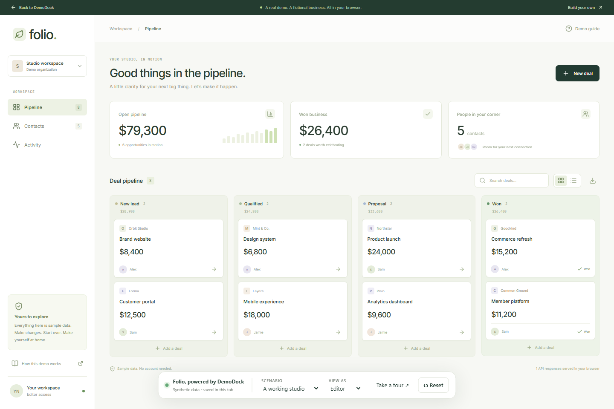
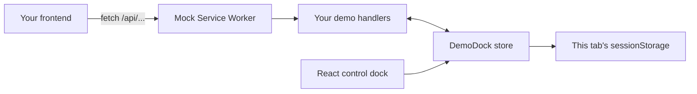

<div align="center">

# DemoDock

**Your app. Their playground.**

Give visitors a working product demo with their own sample data, simulated roles, and a reset button. Deploy it as static files.

[Try the playground](https://demodock.rufaitlabs.cloud/demo) · [Documentation](https://demodock.rufaitlabs.cloud/docs) · [Download the starter](https://github.com/rufait77/DemoDock/releases/latest)

[](https://github.com/rufait77/DemoDock/actions/workflows/ci.yml)
[](LICENSE)

</div>



A screenshot can show what your product looks like. A demo lets someone find out what it feels like.

DemoDock combines a small TypeScript state store, [Mock Service Worker](https://mswjs.io/) HTTP mocks, and a React control dock. Your frontend makes real `fetch` calls; handlers return fictional data inside the browser. Each visitor can make changes without a shared demo database to clean up.

## Try it in a minute

Open the [Folio playground](https://demodock.rufaitlabs.cloud/demo). Create a deal, move it along the pipeline, try the Viewer role, change the scenario, and reset. No account required.

To run the complete repository, use Node.js **22.12+** (24 recommended):

```sh
git clone https://github.com/rufait77/DemoDock.git
cd DemoDock
npm ci
npm run dev
```

Open `http://localhost:5173/demo`. The homepage and documentation are at `/` and `/docs`.

## Build your own demo

**Quickest:** [download the starter ZIP](https://demodock.rufaitlabs.cloud/downloads/demodock-starter.zip), extract it, and run `npm install` followed by `npm run dev`. It contains a standalone React/Vite task app and the SDK tarball in `vendor/`.

Or generate a starter from this repository:

```sh
npm run build:sdk
npm run create-demo -- ../my-product-demo
cd ../my-product-demo
npm install
npm run dev
```

The generator refuses to overwrite a non-empty directory. Change the seed data and handlers in `src/demo.ts`, then build your interface in `src/main.tsx`.

For an existing frontend, install the versioned release artifact:

```sh
npm install https://github.com/rufait77/DemoDock/releases/download/v0.1.0/rufait77-demodock-0.1.0.tgz msw@^3
npx msw init public --save
```

The SDK is distributed through GitHub Releases in v0.1.0; it is not yet published to the npm registry. React is only needed for the optional dock.

```ts
import { createDemo } from '@rufait77/demodock';
import { http, HttpResponse } from 'msw/http';

export const demo = createDemo({
  id: 'my-product',
  version: 1,
  roles: [{ id: 'editor', label: 'Editor' }],
  scenarios: [{
    id: 'welcome',
    label: 'A fresh start',
    seed: () => ({ tasks: ['Explore the demo'] }),
  }],
  handlers: store => [
    http.get('/api/tasks', () =>
      HttpResponse.json(store.getSnapshot().data.tasks)
    ),
  ],
});

// Start the worker before mounting your app or making API requests.
await demo.start();
```

Add the controls to a React app:

```tsx
import { DemoDock } from '@rufait77/demodock/react';
import '@rufait77/demodock/styles.css';

<DemoDock demo={demo} />
```

See the [SDK reference](packages/demodock/README.md) and [integration guide](https://demodock.rufaitlabs.cloud/docs#integrate) for state updates, custom roles, scenarios, persistence, and guided tours.

## What ships

| Capability | v0.1.0 |
| --- | --- |
| Stateful HTTP mocks | Write GET/POST/PATCH/DELETE handlers with MSW 3 |
| Isolated demo state | Session storage by default; memory/custom adapters available |
| Scenarios and reset | Deterministic seeds; reset keeps the selected role |
| Role simulation | A role selector; mock handlers enforce the permissions |
| React controls | Scenario, role, reset confirmation, and guided tour |
| Working example | Folio CRM: deals, contacts, search, list/board views, activity, JSON export |
| Starter | Independent React/Vite task app, with bundled SDK |
| Static deployment | No application backend or database required |

## How it works



The app still needs a static host to load. DemoDock does not cache the entire site for offline use. An opened or duplicated tab may inherit the browser's initial sessionStorage copy; changes afterward are independent. Separate browser sessions start fresh.

## Scope and tradeoffs

- **You write the mocked behavior.** DemoDock does not convert backend code into mocks. Start with one product flow and add handlers as needed.
- **Client-rendered apps and HTTP first.** React has the ready-made UI. The state store also has a framework-independent `@rufait77/demodock/store` entrypoint. SSR adapters, GraphQL examples, and other UI adapters are future work.
- **Use synthetic data and a separate demo deployment.** Frontend source, fixtures, and role controls are public. Roles are not authentication or a security boundary.
- **Unhandled requests fail after startup.** Unhandled HTTP requests and WebSocket connections are rejected, while same-origin GET page/static assets are allowed. Asset detection uses request metadata and file extensions. Explicit passthrough handlers, pre-start requests, forms, navigation, or unrelated SDKs require your own review. This is not a network security sandbox.
- **Modern browser required.** HTTPS or localhost and service-worker support are the supported configuration. Automated release checks currently cover desktop Chromium and mobile Chromium emulation, not physical devices or every browser.
- **Publish only content you can distribute.** Never ship production credentials, customer data, or private code in a demo bundle.

## Develop and verify

```sh
npm run check                 # TypeScript, state/API tests, production build
npx playwright install chromium
npm run test:e2e              # Desktop + mobile Chromium journeys
npm run release:pack          # SDK tarball and standalone starter folder
```

The end-to-end tests cover CRUD, refresh persistence, reset, scenarios, permissions, visitor isolation, unhandled-request rejection, tours, and mobile layout. [CI](.github/workflows/ci.yml) also builds a generated starter.

```
packages/demodock/   SDK, state store, React dock
apps/web/           Website, handbook, Folio example
templates/          Standalone React/Vite starter
tests/              Unit/API and browser checks
scripts/            Scaffold, packaging, and visual assets
deploy/             Example Nginx configuration
```

Contributions and concrete use cases are welcome. See [CONTRIBUTING.md](CONTRIBUTING.md) and the [roadmap](docs/ROADMAP.md). If this would make your next product easier to try, a star helps other builders find it.

## Credits and license

Built by [Rufait Islam Nahin](https://github.com/rufait77). DemoDock is [MIT licensed](LICENSE). Network interception is powered by MSW; the project also uses React, Vite, Lucide, Inter, and JetBrains Mono. Third-party components retain their own licenses. Folio and its sample business data are fictional.
